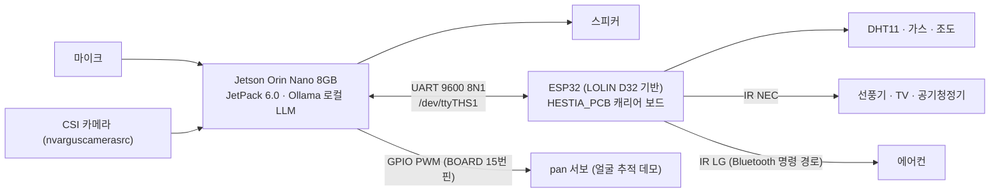

# HESTIA_HW — 하드웨어 구성 개요

HESTIA의 하드웨어 연결 구성을 정리한 문서입니다. 회로/PCB 파일은 [HESTIA_PCB](https://github.com/MJU-HESTIA/HESTIA_PCB), 펌웨어는 [HESTIA_FW](https://github.com/MJU-HESTIA/HESTIA_FW), Jetson 소프트웨어는 [HESTIA_SW](https://github.com/MJU-HESTIA/HESTIA_SW)에 있습니다.

> **English summary** — Hardware overview: Jetson Orin Nano (main computer, local LLM) connected over UART to an ESP32 (LOLIN D32-based) carrier board that reads sensors and drives IR appliances; CSI camera, microphone and speaker on the Jetson.

## 전체 구성

| 구성 요소 | 내용 (코드/회로도 근거) |
|---|---|
| 메인 컴퓨터 | Jetson Orin Nano 8GB, JetPack 6.0 (L4T 36.3.0) |
| MCU | ESP32 — 회로도 기준 LOLIN D32(ESP32-WROOM-32). IoT 가전 제어·센서 통합 담당 |
| 센서 | DHT11(GPIO19), 가스 디지털 출력(GPIO34), 조도 디지털 출력(GPIO27) |
| 가전 제어 | IR 송신 모듈 (Arduino-IRremote, NEC / LG 프로토콜) |
| 링크 | Jetson `/dev/ttyTHS1` ↔ ESP32 UART2(GPIO16/17), 9600 8N1 |

## 작성 예정
- BOM(모델명·수량), 배선 사진, 전원 분배(서보 전원 분리 여부), 하우징 자료

## My role
**이승석** — 전체 시스템 통합(Jetson ↔ ESP32 연동), ESP32 펌웨어, IR 가전 제어.
